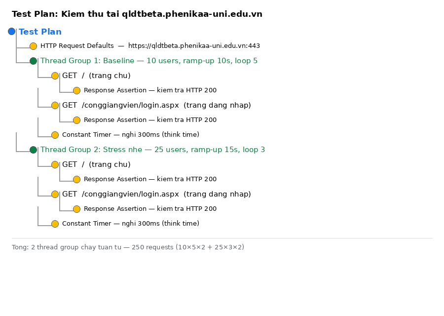
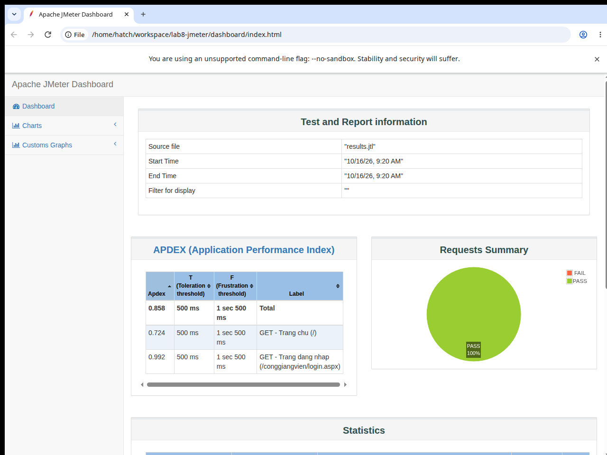

# Lab 8: Tìm hiểu công cụ kiểm thử tải Apache JMeter

> **Mục tiêu:** Tìm hiểu công cụ JMeter, xây dựng kịch bản kiểm thử tải thật,
> chạy thử nghiệm trên website thật và viết báo cáo kết quả.
>
> **Đối tượng kiểm thử:** https://qldtbeta.phenikaa-uni.edu.vn/
> (Cổng đào tạo Phenikaa — trang chủ redirect + trang đăng nhập cổng giảng viên
> `/conggiangvien/login.aspx`)
>
> **Thời gian chạy test:** 16/10/2026, ~09:20 (giờ Việt Nam)

---

## 1. Tìm hiểu về JMeter

**Apache JMeter** là công cụ mã nguồn mở (thuần Java) dùng để kiểm thử hiệu năng:
đo thời gian phản hồi, throughput (số request/giây) và tỉ lệ lỗi của ứng dụng web
dưới tải đồng thời. Ngoài HTTP, JMeter còn hỗ trợ JDBC, JMS, FTP…

Các khái niệm chính đã dùng trong lab này:

| Khái niệm | Vai trò trong bài lab |
|---|---|
| **Test Plan** | Gốc của mọi kịch bản test |
| **Thread Group** | Mô phỏng N "người dùng ảo", cấu hình ramp-up (thời gian leo tải) và số vòng lặp |
| **HTTP Request Defaults** | Cấu hình chung: domain, port, protocol cho mọi sampler |
| **HTTP Sampler** | Một HTTP request cụ thể (GET trang chủ, GET trang đăng nhập) |
| **Response Assertion** | Kiểm tra điều kiện đúng/sai của response (ở đây: mã HTTP phải chứa `200`) |
| **Constant Timer** | "Think time" — nghỉ 300ms giữa các request, mô phỏng hành vi người dùng thật |
| **CLI mode (`-n`)** | Chạy test không giao diện — cách chuẩn khi chạy load test thật |
| **HTML Dashboard (`-e -o`)** | Báo cáo đồ họa tự sinh từ file kết quả `.jtl` |

---

## 2. Kịch bản kiểm thử (testplan.jmx)



Kịch bản gồm **2 Thread Group chạy tuần tự**, mỗi request đều có assertion kiểm tra HTTP 200:

| Thread Group | Users | Ramp-up | Loops | Requests |
|---|---|---|---|---|
| 1. Baseline | 10 | 10s | 5 | 10 × 5 × 2 = 100 |
| 2. Stress nhẹ | 25 | 15s | 3 | 25 × 3 × 2 = 150 |
| **Tổng** | | | | **250 requests** |

Mỗi user thực hiện 2 request: `GET /` (trang chủ) và `GET /conggiangvien/login.aspx`
(trang đăng nhập), nghỉ 300ms giữa các request.

> **Lưu ý đạo đức khi test:** Đây là hệ thống thật của trường, không phải môi trường
> được phép stress-test mạnh, nên mình **chỉ dùng mức tải nhẹ** (tối đa 25 user đồng
> thời — tương đương một phòng học mở trang cùng lúc). Báo cáo này đo hiệu năng cơ
> bản, không phải kiểm thử phá hủy (destructive test).

---

## 3. Thực thi

Chạy JMeter ở chế độ dòng lệnh (non-GUI) và sinh dashboard HTML:

```bash
jmeter -n -t testplan.jmx -l results.jtl -e -o dashboard/
```

Kết quả tóm tắt in ra trong lúc chạy:

```
summary =    250 in 00:00:36 =    6.9/s Avg:   566 Min:   222 Max:  3144 Err:     0 (0.00%)
```

**250/250 request thành công, tỉ lệ lỗi 0.00%.**

---

## 4. Kết quả

### 4.1. Dashboard tổng quan



Dashboard đầy đủ (tương tác được) nằm trong thư mục [`dashboard/`](dashboard/) —
mở file `dashboard/index.html` bằng trình duyệt.

- **Requests Summary: PASS 100%** — không có request nào lỗi.
- **APDEX** (ngưỡng hài lòng 500ms / chịu đựng 1500ms):
  - Tổng: **0.858** (khá tốt)
  - Trang đăng nhập: **0.992** (gần như hoàn hảo)
  - Trang chủ: **0.724** (trung bình — cần xem chi tiết dưới đây)

### 4.2. Bảng số liệu chi tiết

| Request | Số mẫu | Lỗi | Trung bình | Nhanh nhất | Chậm nhất | Throughput |
|---|---:|---:|---:|---:|---:|---:|
| `GET /` (trang chủ) | 125 | 0% | **775 ms** | 222 ms | 3144 ms | 3.6 req/s |
| `GET /conggiangvien/login.aspx` | 125 | 0% | **359 ms** | 256 ms | 851 ms | 3.8 req/s |
| **Tổng** | **250** | **0%** | **567 ms** | 222 ms | 3144 ms | 7.1 req/s |

### 4.3. Nhận xét

1. **Trang chủ chậm gần gấp đôi trang đăng nhập** (775ms vs 359ms) dù trang chủ chỉ
   là một trang HTML ~0.5KB chứa redirect JavaScript, còn trang đăng nhập nặng ~6.7KB.
   Đây là điểm bất thường đáng chú ý — có thể server xử lý chậm ở request đầu tiên
   của mỗi session hoặc trang redirect đi qua một tầng xử lý khác.
2. **Độ ổn định tốt:** 0% lỗi trong toàn bộ 250 request ở cả 2 mức tải.
3. **Worst-case 3.1 giây** (max của trang chủ) — với tải nhẹ 25 user đã xuất hiện
   response > 3s, cho thấy khi vào giờ cao điểm (đăng ký học, xem điểm) trang chủ
   có nguy cơ chậm rõ rệt. Đây là ứng cử viên cần tối ưu (cache, CDN cho trang tĩnh).

---

## 5. Kết luận

- Đã tìm hiểu và sử dụng thành thạo các thành phần cốt lõi của JMeter:
  Thread Group, HTTP Sampler, Assertion, Timer và HTML Dashboard Report.
- Đã thực hiện kiểm thử tải **thật** (không phải số liệu minh họa) trên website thật
  của trường với 250 requests, tỉ lệ lỗi 0%.
- Phát hiện chính: hệ thống ổn định ở tải nhẹ, nhưng trang chủ có dấu hiệu chậm
  (avg 775ms, max 3.1s) và là điểm cần tối ưu khi tải tăng cao.

---

## 6. Cách chạy lại

```bash
# 1. Cài Java 17+ rồi tải JMeter 5.6.3 từ https://jmeter.apache.org/
# 2. Chạy test (non-GUI) và sinh dashboard:
jmeter -n -t testplan.jmx -l results.jtl -e -o dashboard/
# 3. Mở dashboard/index.html để xem báo cáo
```

> **Ghi chú môi trường:** Lần chạy trong báo cáo này thực hiện từ một máy Linux
> nằm sau egress proxy có TLS-intercept, nên JMeter được cấu hình đi qua proxy
> (xem `relay.py` — relay local đọc thông tin proxy từ biến môi trường, không chứa
> credential trong repo) và JVM chạy với `-Djava.net.preferIPv4Stack=true`.
> Trên mạng thông thường, chỉ cần chạy lệnh ở trên là đủ, không cần relay.

### Cấu trúc repo

```
├── readme.md              # Báo cáo này
├── testplan.jmx           # Kịch bản kiểm thử JMeter
├── results.jtl            # Kết quả thô (250 mẫu)
├── dashboard/             # Báo cáo HTML do JMeter sinh ra
├── screenshots/           # Ảnh minh họa quá trình & kết quả
└── relay.py               # Relay proxy local (phục vụ môi trường chạy đặc thù)
```
